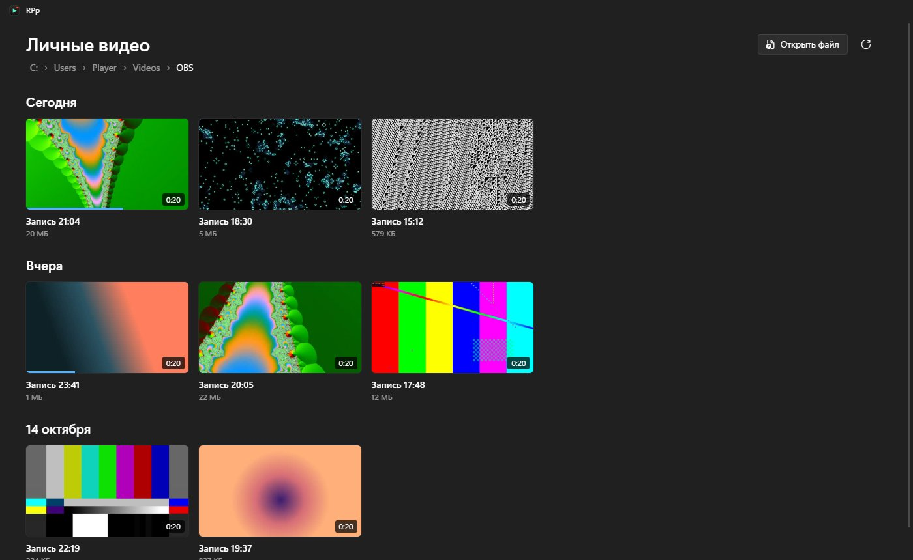
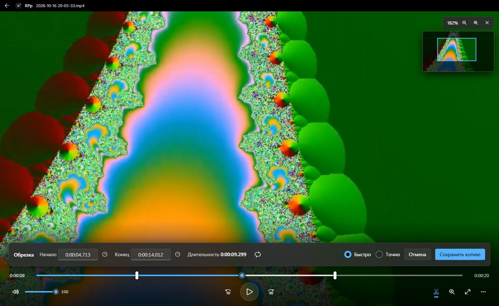

<h1 align="center">RPp</h1>

Бесплатный плеер для записей OBS: библиотека с превью, приближение картинки, покадровый просмотр и обрезка без потери качества.

  <a href="https://github.com/sempik/RPp/releases/latest/download/RPp-Setup.exe"><b>Скачать для Windows</b></a>
  &nbsp;·&nbsp;
  <a href="https://github.com/sempik/RPp/releases/latest/download/RPp-portable.zip">Версия без установки (zip)</a>
  &nbsp;·&nbsp;
  <a href="https://github.com/sempik/RPp/releases">Все версии</a>

## Что умеет

- **Библиотека записей.** Все видео из папки показываются плитками с кадром из записи и длительностью, сгруппированы по дням. Время начала берётся из имени файла OBS. Плеер помнит, где вы остановились.
- **Огромные файлы.** Записи на десятки гигабайт открываются сразу, перемотка мгновенная.
- **Приближение до 16×** колесом мыши, точно к курсору. Миникарта показывает, какую часть кадра вы видите. Режим «чёткие пиксели» помогает прочитать мелкий текст и ники.
- **Обрезка.** Отметьте начало и конец и сохраните копию фрагмента рядом с исходником:
  - **Быстро** — без перекодирования: за секунды и в исходном качестве. Начало может сдвинуться к ближайшему ключевому кадру (обычно не больше 1–2 с).
  - **Точно** — с перекодированием, ровно до кадра. Используется видеокарта NVIDIA, AMD или Intel, если она есть.
- **Покадровый просмотр**, скорость от 0,25× до 4×, повтор фрагмента, копирование времени кадра.
- **Внешний вид Windows 11**: системный акцентный цвет, шрифт и иконки, как в приложении «Кино и ТВ».

## Установка

1. Скачайте [RPp-Setup.exe](https://github.com/sempik/RPp/releases/latest/download/RPp-Setup.exe) и запустите. Права администратора не нужны.
2. Если Windows покажет «Система Windows защитила ваш компьютер», нажмите **Подробнее** → **Выполнить в любом случае**. Так бывает с любой программой без платной цифровой подписи.
3. RPp появится в «Пуске» и на рабочем столе, а видеофайлы можно открывать через **Открыть с помощью → RPp**.

Новые версии RPp находит сам и показывает кнопку «Доступна версия…».

Требования: Windows 10 или 11, 64 бита.

## Горячие клавиши

| Клавиши | Действие |
|---|---|
| Пробел, K | Воспроизвести или приостановить |
| ← → | Назад и вперёд на 5 с (с Shift на 1 с) |
| J, L | Назад на 10 с, вперёд на 30 с |
| , . | Предыдущий и следующий кадр |
| [ ] | Медленнее и быстрее |
| колесо мыши, + − | Увеличить к курсору |
| 0, двойной щелчок | Исходный размер |
| T | Обрезать |
| I, O | Начало и конец фрагмента |
| Ctrl+Enter | Сохранить копию фрагмента |
| Ctrl+C | Скопировать текущее время |
| F, Esc | Во весь экран и выход из него |
| Backspace | Вернуться к библиотеке |

## Сборка из исходников

Приложение написано на [Electron](https://www.electronjs.org/) без зависимостей из npm: весь код в папке `app/`.

1. Положите в папку `vendor/`:
   - `electron.zip` — [Electron v44.8.0 для win32-x64](https://github.com/electron/electron/releases/download/v44.8.0/electron-v44.8.0-win32-x64.zip);
   - `ffmpeg.exe` и `ffmpeg-LICENSE.txt` — из [сборки FFmpeg essentials](https://github.com/GyanD/codexffmpeg/releases) (папка `bin` и файл `LICENSE`);
   - `rcedit-x64.exe` — из [electron/rcedit](https://github.com/electron/rcedit/releases).
2. Установите [Inno Setup 6](https://jrsoftware.org/isinfo.php): `winget install JRSoftware.InnoSetup`.
3. Запустите `powershell -ExecutionPolicy Bypass -File build.ps1`. Установщик и zip появятся в `dist/`.

## Лицензии

Код RPp распространяется по лицензии [MIT](LICENSE). В сборку входят [Electron](https://github.com/electron/electron) (MIT) и [FFmpeg](https://ffmpeg.org) (GPL v3, сборка [gyan.dev](https://www.gyan.dev/ffmpeg/builds/), исходный код FFmpeg — на [ffmpeg.org](https://ffmpeg.org/download.html)). RPp не связан с проектом OBS Studio.
